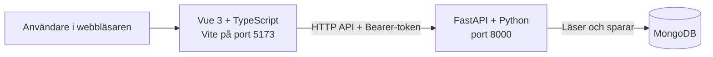
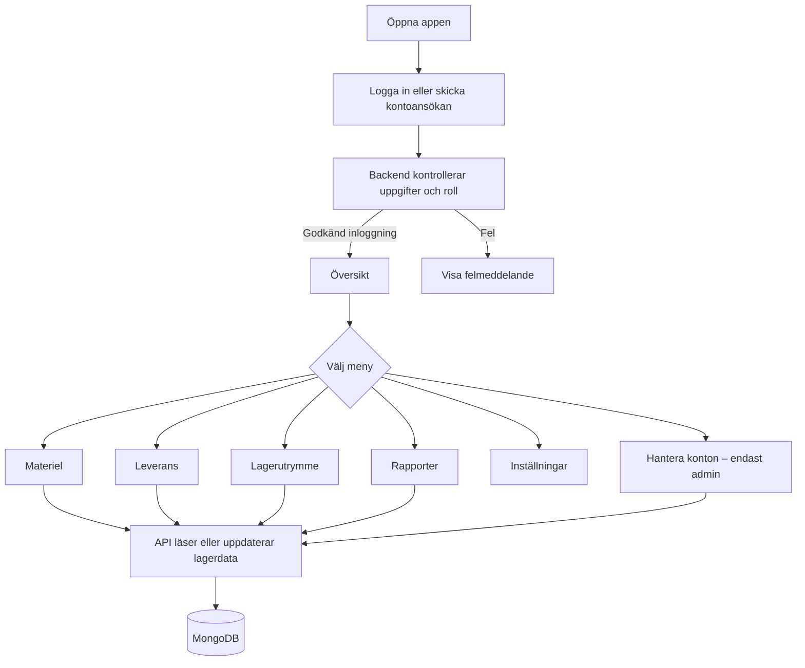

# Arbetsflöde och projektguide – Smart Lagring

Den här guiden förklarar hur appen startas, hur delarna hänger ihop och vad som händer när en användare arbetar i Smart Lagring.

## 1. Projektet i korthet

Smart Lagring består av tre delar:



- **Frontend** visar sidor, formulär och lagerstatus.
- **Backend** kontrollerar behörighet och regler, och utför ändringar via API:et.
- **MongoDB** lagrar konton, material, lager, leveranser, rapporter och aktivitet.

Frontendens huvudsakliga skal och meny finns i `frontend/src/Main.vue`. Backendens startpunkt är `backend/main.py`, som laddar FastAPI-appen från `backend/workspace/main.py`.

## 2. Starta projektet lokalt

Starta backend och frontend i **två separata terminaler** från projektmappen.

### Terminal 1 – backend

```powershell
Set-Location C:\Users\allis\Documents\PROJECT\Inventory-managment
.\.venv\Scripts\python.exe -m uvicorn backend.main:app --host 127.0.0.1 --port 8000
```

Backend behöver en fungerande MongoDB-adress i `backend/.env`. Kontrollera att servern svarar:

```powershell
curl.exe http://127.0.0.1:8000/health
```

Ett fungerande svar innehåller `{"status":"healthy"}`.

### Terminal 2 – frontend

```powershell
Set-Location C:\Users\allis\Documents\PROJECT\Inventory-managment\frontend
npm run dev
```

Öppna sedan `http://localhost:5173/`.

Andra användbara frontendkommandon:

```powershell
npm run build       # Vue/TypeScript-kontroll och produktionsbygge
npm run type-check  # Endast typkontroll
npm run lint        # Projektets lint-kontroller
```

## 3. Vanligt användarflöde



Efter lyckad inloggning skickar frontend en signerad bearer-token med skyddade API-anrop. Tokenen innehåller rollen och gäller i åtta timmar. Administratörsfunktioner kräver rollen `Admin`; vanliga lagerfunktioner kräver inloggning.

### Tvåfaktorsautentisering (2FA)

Vid kontoansökan kan användaren välja att aktivera 2FA. Då skannar personen QR-koden med en authenticator-app och anger en aktuell sexsiffrig kod för att verifiera konfigurationen. När administratören godkänner ansökan sparas kontot med 2FA aktiverat. Framtida inloggningar kräver då både lösenord och en giltig authenticator-kod.

Det lokala utvecklingskontot `admin@dev.local` går genom en särskild utvecklingsväg i backend som utfärdar en token utan att verifiera lösenord eller 2FA. Det kontot och den vägen ska inte användas som produktionssäkerhet.

## 4. Vad användaren gör i varje del

### Översikt

Visar antal enheter, antal artikeltyper, skadade enheter, senaste aktivitet och lagerkapacitet. Översikten hämtar material, kapacitet och aktivitet från API:et.

### Materiel

1. Vyn hämtar material från `GET /materials`.
2. Användaren söker och filtrerar material.
3. En administratör kan registrera material eller uppdatera materialets golvmått.
4. Backend kontrollerar lager, artikelnummer, mängder och kapacitetsregler innan ändringen sparas.

### Leverans

1. En administratör väljer material och antal för en utgående kundleverans.
2. Backend kontrollerar att lagret finns och att tillräckligt många oskadade enheter finns.
3. Lagret minskas när leveransen skapas.
4. Administratören kan markera leveransen som klar eller avbryta den. En avbruten leverans återför materialet till lagersaldot.
5. Viktiga händelser registreras i aktivitetsloggen.

### Lagerutrymme

Beläggningen räknas från materialens golvyta:

```text
längd i cm × bredd i cm × antal ÷ 10 000 = upptagen yta i m²
```

Stapling ingår inte. Om ett material saknar mått visas uppmätt yta som ett **minimum**; värdet är då inte en fullständig beräkning. Administratörer kan uppdatera lagerkapacitet och materialmått.

### Konton

1. En person skickar en kontoansökan.
2. Ansökan sparas som väntande.
3. En administratör godkänner eller avslår den.
4. Vid godkännande skapas ett konto med rollen `Worker`.
5. Administratörer kan hantera användarkonton och roller.

### Rapporter

1. Administratören öppnar **Ny rapport**.
2. Välj rapporttyp, lager och datumperiod; lägg till en valfri beskrivning.
3. Frontend kontrollerar datumintervallet och skickar en begäran till `POST /reports`.
4. Backend bygger rapporten utifrån material, leveranser, kapacitet eller aktivitetslogg och sparar den.
5. Sparade rapporter hämtas från `GET /reports`, visas i rapportarkivet och kan expanderas för att se raderna.

Rapporttyper: lageröversikt, leveranser, lågt lagersaldo, skador, lagerutrymme och aktiviteter. Datumperioden filtrerar leveranser och aktiviteter. Lageröversikt, lagersaldo, skador och lagerutrymme beskriver nuläget.

### Inställningar

Användaren kan uppdatera visningsnamn, profilbild och färgtema. Dessa profilval lagras lokalt i webbläsaren för den aktuella profilen; de skickas inte till MongoDB.

## 5. Backend och data

Backendens routermoduler ligger i `backend/workspace/routers/`:

| Område | Router | Huvudsaklig data |
|---|---|---|
| Inloggning och inloggningshistorik | `auth.py` | `Medlem`, `audit_logs` |
| Kontoansökningar | `applications.py` | `register-validering`, `Medlem` |
| Konton och roller | `members.py` | `Medlem` |
| Material och kapacitet | `materials.py` | `material`, `warehouse` |
| Utgående leveranser | `shipments.py` | `deliveries`, `material`, `audit_logs` |
| Rapporter | `reports.py` | `generated_reports` och källdata |
| Senaste aktivitet | `activity.py` | `audit_logs` |

Modeller och valideringsregler definieras i `backend/workspace/models.py`. MongoDB-anslutningen använder `MONGODB_URI` och, om det är konfigurerat, `MONGODB_DB_NAME` från `backend/.env`. Spara aldrig databaslösenord eller andra hemligheter i källkod eller dokumentation.

## 6. Seeddata är inte automatisk

`backend/database/seed.py` är ett separat engångsskript. Det körs **inte** när backend startar. Om skriptet körs ansluter det till den konfigurerade databasen och kan skapa exempelkonton, lager och annan startdata. Kör det endast när du avsiktligt vill fylla databasen med seeddata; vanlig appstart ska inte återställa eller fylla på databasen.

`backend/database/init_db.py` beskriver index som kan initieras separat. Appen skapar inte automatiskt exempelmaterial vid uppstart.

## 7. Felsökning

| Symptom | Kontrollera |
|---|---|
| Frontenden öppnas inte | Kör `npm run dev` från `frontend` och öppna adressen som Vite visar. |
| API-anrop ger `Not Found` | Kontrollera att backend använder den senaste koden och starta om Uvicorn efter backendändringar. Kontrollera `/openapi.json` för den aktuella rutten. |
| API-anrop ger `401` | Logga in igen; kontrollera att begäran skickar en giltig bearer-token. |
| API-anrop ger `403` | Åtgärden kräver administratörsbehörighet. |
| Backend ger `503` | Kontrollera att MongoDB är åtkomlig och att `backend/.env` innehåller rätt anslutningsinställning. |
| Ändringar syns inte i webbläsaren | Uppdatera sidan och kontrollera Vites terminal för kompileringsfel. |

## 8. Börja felsöka i rätt ordning

```text
Webbläsare → frontendens komponent → HTTP-anrop → FastAPI-router
            → Pydantic-modell/behörighet → MongoDB → JSON-svar → vyuppdatering
```

Följ den kedjan från vänster till höger: kontrollera först vilket meddelande eller HTTP-status webbläsaren visar, därefter API-rutten och backendens svar, och sist vilken data som finns i databasen.
