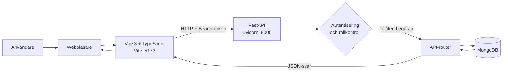
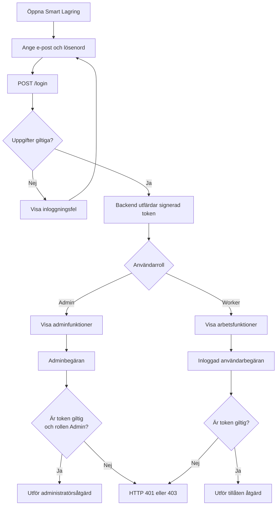
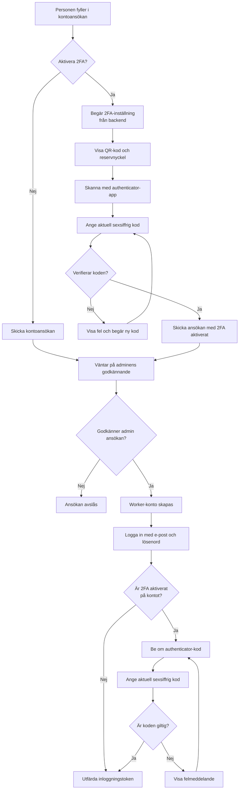
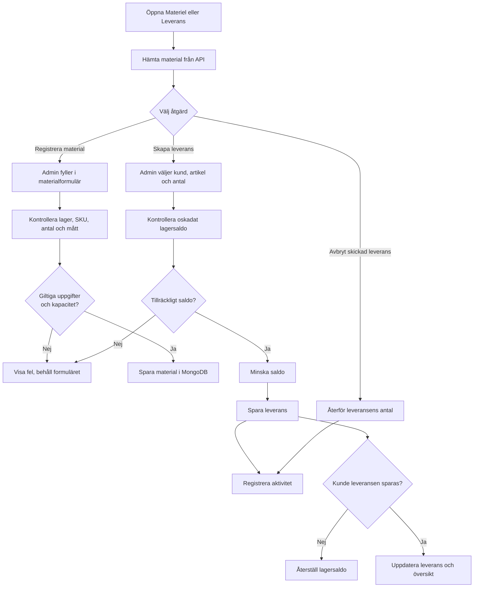
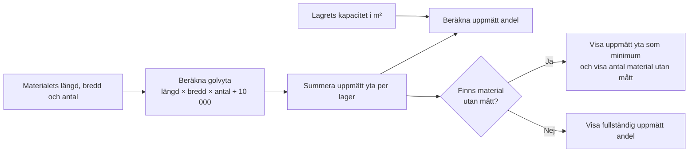
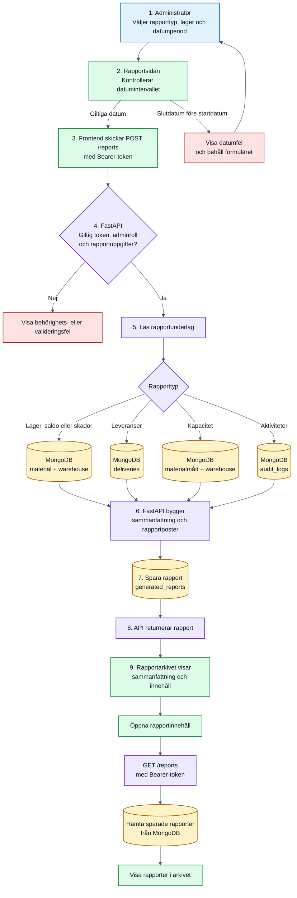

# Smart Lagring – arbetsflöden
## Systemets delar

## Inloggning och behörighet

## Aktivera och använda tvåfaktorsautentisering (2FA)

2FA konfigureras som en del av kontoansökan och aktiveras först när ansökan godkänns. QR-koden/nyckeln kopplas till en authenticator-app; den aktuella koden kontrolleras vid registrering och vid framtida inloggningar.

> **Utvecklingskonto:** den lokala inloggningen `admin@dev.local` har en särskild utvecklingsväg i backend som utfärdar token utan att kräva lösenord eller 2FA. Den vägen är inte exempel på säker produktionskonfiguration.

## Material och utgående leverans

## Lagerutrymme

Stapling räknas inte med. Om mått saknas ska procenten inte tolkas som en fullständig beräkning.

## Skapa och visa rapport

Lageröversikt, lågt lagersaldo, skador och lagerutrymme visar nuläget. Datumperioden används för leverans- och aktivitetsrapporter.

## Ändra en funktion

```mermaid
flowchart LR
    Requirement[Bestäm önskat beteende] --> Vue[Uppdatera Vue-vy eller formulär]
    Vue --> Request[Skicka API-begäran]
    Request --> Model[Validera data i Pydantic-modell]
    Model --> Role[Kontrollera roll i FastAPI-router]
    Role --> Database[Läs eller uppdatera MongoDB]
    Database --> Response[Returnera JSON eller tydligt fel]
    Response --> UI[Visa resultat eller felmeddelande]
    UI --> Verify[Testa frontend, API och relevanta kantfall]
```

## Relaterad projektguide

Se [WORKFLOW.md](./WORKFLOW.md) för instruktioner om att starta projektet, detaljer för varje vy och felsökning.
